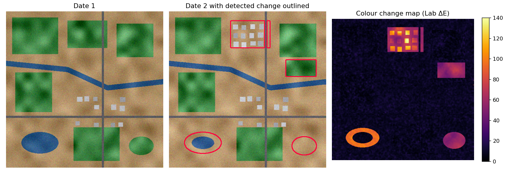
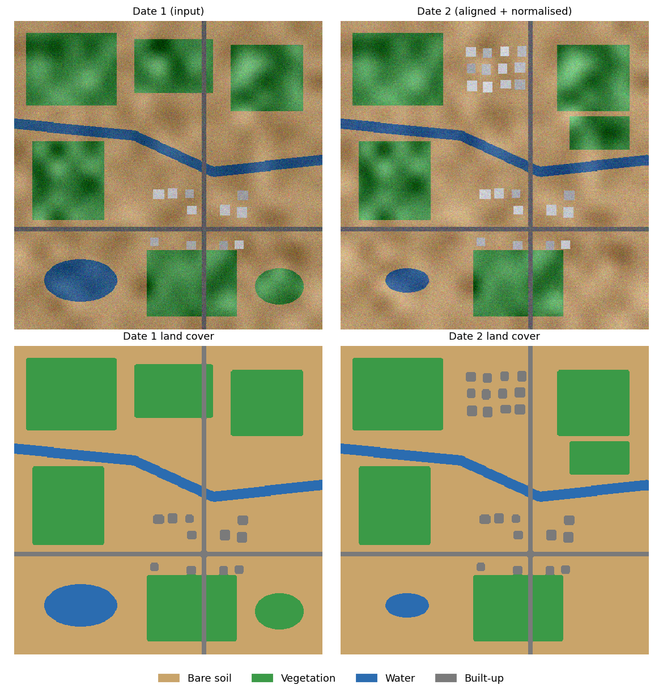

# TerraLens — Classical-CV Land-Cover & Change Analyzer

TerraLens takes two RGB images of the same area from different dates and reports **what changed into what** —
without training labels or a GPU. It registers and normalises the pair, classifies each date into
**bare soil / vegetation / water / built-up**, counts buildings, finds road lines, and writes a from→to
transition table in hectares.

> **Honesty note.** All measured numbers below come from procedurally generated scenes with exact ground truth.
> TerraLens has **not** been validated on real satellite imagery. See *Limitations*.

## Pipeline
`ECC registration → radiometric normalisation → bilateral denoise → K-Means (Lab) + colour-rule naming → mode filter → buildings/roads → class-transition ∧ ΔE gate → change mask`

Techniques: ECC image alignment, robust mean/std normalisation, bilateral filtering, K-Means in CIELAB,
majority filtering, morphological opening, connected components, probabilistic Hough transform,
Lab colour difference with Otsu thresholding.

## Results (5 held-out seeds, mean ± std)
| | TerraLens | Baseline |
|---|---|---|
| Land-cover pixel accuracy | 0.9986 ± 0.0001 | 0.9495 ± 0.0004 (pixelwise rules, raw image) |
| Land-cover mean IoU | 0.9936 ± 0.0003 | 0.7948 ± 0.0013 |
| Change F1 | 0.9995 | 0.5764 ± 0.0243 (grey diff + Otsu, no alignment) |
| Building count error | 0 on all 10 dates | – |
| Registration error | 0.09 px | – |

Rules were developed on seeds 1–3; the table uses seeds 11–15. The scene **layout and change events are fixed**;
seeds vary noise, texture and building placement — so this measures robustness, not generalisation.
Full details: `TerraLens_Project_Report.pdf`, `outputs/benchmark_results.json`.




## Install & run
```bash
git clone https://github.com/heyanantsingh/TerraLens.git
cd TerraLens
python -m venv venv && venv\Scripts\activate      # Windows
pip install -r requirements.txt
python main.py --demo                              # synthetic pair -> outputs/
python main.py --before a.png --after b.png --gsd 10
pytest                                             # 17 tests
python docs/build_report.py                        # rebuild PDF from measured JSON
```
`--gsd` is metres per pixel of your imagery (default 10 is a placeholder).

## Structure
```
TerraLens/
├── docs/        architecture, workflow, use case, sequence, class diagrams, build_report.py
├── input/       demo_before.png, demo_after.png
├── outputs/     figures, analysis_report.json, benchmark_results.json
├── screenshots/
├── src/         synthetic, preprocess, classify, features, change, evaluate, figures, report
├── tests/       test_project.py (17 tests)
├── main.py  requirements.txt  statement.md  TerraLens_Project_Report.pdf
```

## Limitations
- No real-imagery validation; synthetic scenes lack shadows, clouds, seasonal change, mixed pixels.
- Fixed scene layout in the benchmark; no per-stage ablation was run.
- RGB only (no NIR/NDVI); translation-only registration.
- Hough output is qualitative (overlapping detections ≠ road count); touching buildings would merge.
- Hectares depend on the GSD you supply.

## Future work
Real Sentinel-2/aerial pairs, NIR + NDVI, ORB+RANSAC registration, shadow/cloud masks, road length by skeletonisation.
