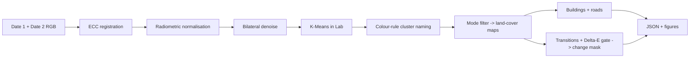

# Architecture

| Module | Responsibility |
|---|---|
| `src/synthetic.py` | Scene generator with exact ground truth (benchmark + demo) |
| `src/preprocess.py` | Denoise, ECC alignment, radiometric normalisation |
| `src/classify.py` | Lab K-Means, rule naming, mode filter, pixelwise baseline |
| `src/features.py` | Building blobs (opening + extent filter), road lines (Hough) |
| `src/change.py` | Multi-date change detection, transition matrix, naive baseline |
| `src/evaluate.py` | Accuracy / IoU / precision / recall / F1 |
| `src/figures.py`, `src/report.py` | Matplotlib figures, JSON report |
